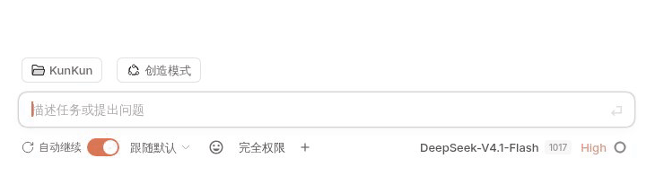

# dsh-ghost-input · Inline ghost-text continuation

[**简体中文**](README.md) · [English](README.en.md)


Stop typing for a moment and the model finishes your sentence in grey — press `Tab` to keep it.



> A DeepSeek Harness (DSH) plugin for DSH 0.2.0 or newer.

## What it does

Write half a sentence in the composer, pause for about 0.6 s, and the plugin continues it in light grey using the model already selected for the session. Accept with `Tab`, or just keep typing to discard.

It continues **your sentence**, not the next thing you should ask, and it reads the last few turns plus the workspace name to stay in your vocabulary.

## Features

- **Inline continuation** at the caret, up to ~80 characters, truncated to the line width
- **Subtle hint**: a small `Tab` key cap after the ghost text (the label is configurable)
- **Accept / dismiss**: `Tab` accepts and moves the caret to the end; `Esc`, typing, moving the caret or switching sessions discards
- **Only when it makes sense**: caret at the end, no selection, no IME composition; skipped when the draft starts with `/` or `@`
- **Works on phones**: switch accept mode to "phone (tap)" — tap the grey text, or use the `⇥ 补全` chip (tap accepts, long-press dismisses)
- **Can be turned off**: one switch in settings stops every request
- **Cached**: the same draft reuses its result for 45 seconds

## Installation

**Option 1 — release tarball (recommended)**

```bash
dsh plugin --profile web add https://github.com/KunKun24/dsh-ghost-input/releases/download/v0.2.3/dsh-ghost-input-0.2.3.tgz
```

**Option 2 — local source**

```bash
dsh plugin --profile web add link:/path/to/dsh-ghost-input
```

**Option 3 — plugin marketplace**

Submitted ([PR #18779](https://github.com/awesome-dsh-plugin/awesome-dsh-plugin/pull/18779)); once merged, search `dsh-ghost-input` in the marketplace.

Reload the page afterwards.

## Usage

1. Type half a sentence and pause
2. Wait for the grey text (about 0.6 s plus the model's first token)
3. Press `Tab` to accept, or keep typing / press `Esc`

## Configuration

Sidebar → "More → 参数设置" (settings). Changes apply immediately and persist to `~/.dsh/ghost-input/settings.json`.

| Option | Default | Meaning |
| --- | --- | --- |
| Enabled | on | Off stops every model request |
| Pause delay | 600 ms | Idle time before asking (200–1500) |
| Max shown characters | 80 | Longest visible continuation (20–200) |
| Output cap | 96 tokens | Per-completion limit (16–512) |
| Temperature | 0.30 | Lower is steadier (0–1) |
| Timeout | 4500 ms | Give up silently after this (500–10000) |
| Key cap label | `Tab` | Text shown on the tiny key cap |
| Accept mode | Desktop (Tab) | Desktop / phone (tap) / auto |
| Use conversation context | on | Off sends only the draft: cheaper, blunter |

## Limits

- Every pause sends a very short model request (cached 45 s); rapid typing in a long session adds up
- Only one line is shown, so long continuations are clipped on screen but accepted in full
- On phones, the grey strip accepts instead of moving the caret
- Depends on the composer's DOM; a major DSH redesign may need an update

## Data & privacy

- The draft is sent to the model provider you already selected, over the normal chat path
- Cached in memory for 45 s only; nothing is written to disk or sent elsewhere
- The plugin itself collects nothing

## Version & author

- Version **0.2.3** ([changelog](CHANGELOG.md))
- Author: 困困 (KunKun) · GitHub [@KunKun24](https://github.com/KunKun24) · Telegram [@sad1881](https://t.me/sad1881)
- License: [MIT](LICENSE)

Contains AIGC-assisted code, reviewed line by line and verified on a real instance (desktop and phone viewports).
