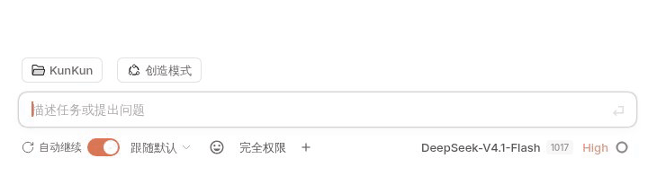

# dsh-ghost-input · 输入框续写

[**简体中文**](README.md) · [English](README.en.md)


打字停下，模型在光标后补出后半句，浅灰显示，`Tab` 收下。



> DeepSeek Harness（DSH）插件，需要 DSH 0.2.0-rc.2 及以上（0.2.0-rc.2 → 0.2.3 全系列实测可用）。

## 它做什么

在对话输入框里写半句话，停一下（约 0.6 秒），插件用**当前会话所选模型**接着写下去，以灰字接在光标后。觉得合适就按 `Tab` 收下，不合适继续打字即可丢弃。

它补的是**你这句话的下半句**，不是下一轮该问什么；会参考最近几轮对话和工作区名，尽量沿用你的用词。

## 功能

- **行内续写**：灰字接在光标后，最多显示约 80 字，超出按行宽截断
- **轻提示**：灰字后浮一个小 `Tab` 键帽（可改成任意文字），提示按键收下
- **收下 / 丢弃**：`Tab` 收下并落光标到末尾；`Esc`、继续打字、移动光标、切会话立即丢弃
- **只在该出现时出现**：光标在草稿末尾、无选中、非输入法拼写中；`/` 与 `@` 开头跳过
- **手机可用**：接受方式切到「手机（轻点）」后，点灰字即收下，输入框上方还有 `⇥ 补全` 药丸（点收下、长按丢弃）
- **可以关**：参数设置里一键关闭，不再向模型发任何请求
- **结果缓存**：同一草稿 45 秒内复用，不会每次停顿都请求

## 安装

**方式一：Release 包（推荐）**

```bash
dsh plugin --profile web add https://github.com/KunKun24/dsh-ghost-input/releases/download/v0.2.4/dsh-ghost-input-0.2.4.tgz
```

**方式二：本地源码**

```bash
dsh plugin --profile web add link:/path/to/dsh-ghost-input
```

**方式三：插件市场**

已投稿（[PR #18779](https://github.com/awesome-dsh-plugin/awesome-dsh-plugin/pull/18779)），合并后可在市场搜索 `dsh-ghost-input` 安装。

装完刷新页面即可。

## 使用

1. 在输入框里写半句话，停住
2. 等灰字出现（约 0.6 秒 + 模型首字延迟）
3. `Tab` 收下；不想要就继续打字或按 `Esc`

## 配置

侧边栏「更多 → 参数设置」可以调全部选项，改完即时生效（保存在 `~/.dsh/ghost-input/settings.json`）。

| 选项 | 默认 | 说明 |
| --- | --- | --- |
| 总开关 | 开 | 关闭后完全不请求模型 |
| 停顿延迟 | 600 ms | 停手多久才去补全（200–1500） |
| 最多显示字数 | 80 | 灰字最长显示多少字（20–200） |
| 输出上限 | 96 | 单次续写的 token 上限（16–512） |
| 采样温度 | 0.30 | 越低越稳、越贴上下文（0–1） |
| 超时 | 4500 ms | 超时静默放弃这次续写（500–10000） |
| 键帽文字 | `Tab` | 小键帽上显示的文字 |
| 接受方式 | 电脑（Tab） | 电脑 / 手机（轻点）/ 自动 |
| 带上对话上下文 | 开 | 关闭后只看当前草稿，省 token 但更泛 |

## 限制与注意

- 每次停顿会发一次很短的模型请求（已缓存 45 秒），长对话连续打字会累积少量 token
- 灰字最多显示一行，续写更长时会被截断显示，但收下的是完整内容
- 手机上灰字那一小条是「收下」，不是移动光标
- 依赖 DSH 输入框的 DOM 结构；大版本改版后可能需要适配

## 数据与隐私

- 草稿会发送给**你当前选择的模型供应商**用于生成续写，与正常对话走同一个通道
- 只在内存里缓存 45 秒，不落盘、不上传到第三方
- 插件自身不收集任何信息

## 版本与作者

- 当前版本 **0.2.4**（[更新日志](CHANGELOG.md)）
- 作者：困困 · GitHub [@KunKun24](https://github.com/KunKun24) · Telegram [@sad1881](https://t.me/sad1881)
- 许可证：[MIT](LICENSE)

包含 AIGC 辅助编写的内容，已逐行人工审阅并在真机验证（桌面与手机视口均实测）。
