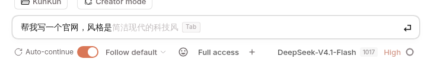

# dsh-ghost-input

[**简体中文**](README.md) · [English](README.en.md)


输入框行内续写（ghost text）——打字停下，模型在光标后补出后半句，灰色显示，`Tab` 收下。



> 这是 DeepSeek Harness（DSH）的插件。没有 DSH 的话，它没地方运行。

## 它做什么

在对话输入框里打半句话，停一下（约 0.6 秒），插件会把**你当前会话所选模型**的续写以浅灰字接在光标后面：

- 灰字后面浮着一个小 `Tab` 键帽，提示按键即可收下；键帽很轻，不抢视觉
- `Tab` — 收下这段续写，光标落到末尾
- `Esc`、继续打字、移动光标、切会话 — 立即丢弃
- 只在光标位于草稿末尾、且没有选中文本时才出现
- 输入法拼写过程中不触发，避免和候选词打架
- 以 `/` 或 `@` 开头时跳过（那是命令和引用的地盘）

续写会参考最近的对话与当前草稿，尽量接住正在聊的话题和措辞；是否值得出现由模型判断：草稿太短、上下文不足、没把握，模型就回空字符串，插件保持安静。

## 安装

### 从 GitHub 装（推荐）

```bash
dsh plugin install https://github.com/KunKun24/dsh-ghost-input
```

或在 DSH 网页端 **插件** → **添加插件** 里填仓库地址。

### 从源码安装

```bash
git clone https://github.com/KunKun24/dsh-ghost-input.git
dsh plugin install ./dsh-ghost-input
```

装好后在 **插件** 里启用 `ghost-input` 行，刷新页面即可。它同时包含宿主侧与浏览器侧代码：

- 宿主侧注册 `POST /api/ghost-input/complete`，通过 `ctx.llm` 用当前会话的模型做一次短补全；
- 浏览器侧监听输入框（Lexical contenteditable）的停顿、`Tab`、输入法事件，把结果渲染成灰色尾注。

## 参数设置

装好后左侧栏会多出一个 **参数设置** 入口：停顿延迟、最多显示字数、输出上限、采样温度、超时、键帽文字、是否带上下文，以及总开关，都在这里改。改动即时保存，下一次停顿就按新参数工作，不用刷新页面；右上角的 GitHub 卡片点一下就跳到仓库，喜欢的话给个 star。

滑块的范围与写入的值由宿主侧统一夹取，写进 `<DSH_HOME>/ghost-input/settings.json`（默认 `~/.dsh/ghost-input/settings.json`），插件升级不会覆盖。

插件行配置仍写在 `cordis.patch.yml`（或插件页面），作为初始值，全部可选：

| 键 | 默认值 | 说明 |
| --- | --- | --- |
| `enabled` | `true` | 总开关 |
| `delayMs` | `600` | 停顿多久之后才请求模型（200–1500ms） |
| `maxTokens` | `96` | 单次续写的输出上限 |
| `temperature` | `0.3` | 采样温度，低一些更稳 |
| `timeoutMs` | `4500` | 单次请求超时，超时静默失败 |
| `maxSuffixChars` | `80` | 显示的最长字数，超出按行宽截断 |
| `hintKey` | `Tab` | 灰字后面键帽上显示的文字 |
| `useContext` | `true` | 是否带上最近对话与工作区名 |

## 成本与隐私

- 每次**停顿后**才请求一次模型，不是每个按键；连续打字只会有一个在途请求，新按键会取消旧的。
- 同一段草稿的返回结果缓存 45 秒，不会重复烧 token。
- 发给模型的内容：最近的对话上下文（少量）+ 当前草稿。它们本来就发给你正在使用的模型提供方，插件不额外外发，也不落盘。

## 已知限制

- 输入框是宿主自绘的 Lexical `contenteditable`，插件用 DOM 事件与其交互（官方未开放 composer 的编辑接口给插件）。DSH 大改输入框结构时可能需要同步适配。
- 灰色续写用输入框最后一段的 `::after` 渲染在光标之后；当官方命令提示（hint）正在显示、或输入法正在拼写时，插件会让位。
- 极短草稿（一两个字）也允许请求，是否续写由模型决定——代价是一次很短的调用。

## AI 使用说明

本插件的代码与文档在 **AIGC（AI 生成内容）辅助**下完成，并已通过开发者的人工审阅：

- 每一行代码都经过人工阅读与修改，不是直接粘贴的生成结果
- 功能在真实 DSH 实例 + 无头浏览器中逐项验证：灰字出现、`Tab` 收下、`Esc` 丢弃、输入法期间不触发、45 秒缓存
- 发布前人工核对了宿主侧路由的鉴权方式、模型调用的成本边界与数据去向

人工审阅不等于零缺陷。使用中若发现与本文描述不符的行为，欢迎在 [Issues](https://github.com/KunKun24/dsh-ghost-input/issues) 反馈。

## 许可证

MIT
